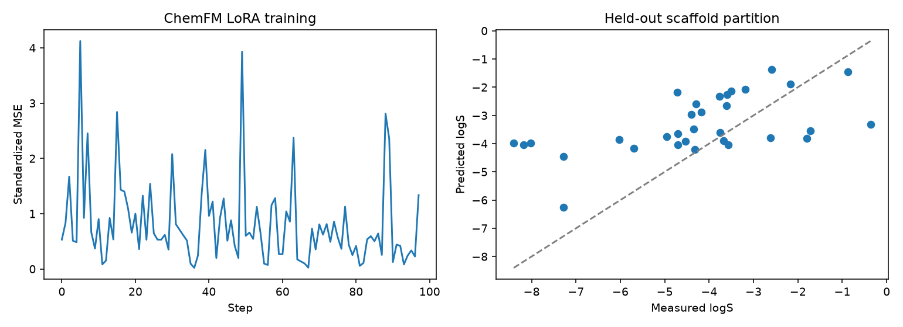
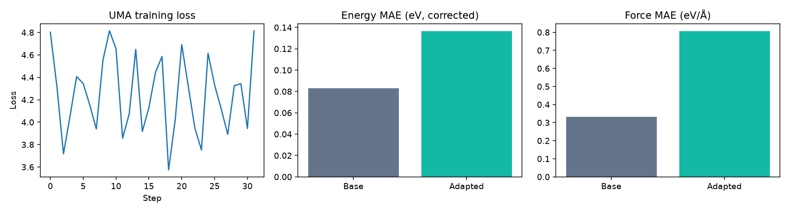
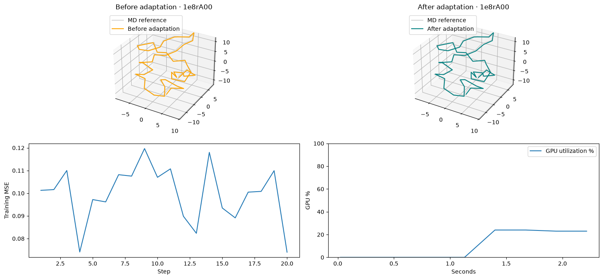

# Model fine-tuning results

The recipes report their own measured outputs. Training loss is not a substitute for held-out evaluation. Checkpoints and complete datasets are not committed.

## Run status

| Recipe | Status |
|---|---|
| ChemFM | GPU fine-tuning and held-out evaluation completed |
| UMA | GPU fine-tuning, checkpoint saving and held-out evaluation completed |
| BioEmu-2 | GPU adaptation completed; measured outputs below |

## ChemFM-1B

Executed on 2026-10-23 with one NVIDIA H200. Three epochs adapted 1,128,448 LoRA and regression-head parameters on 128 ESOL molecules, with 32 validation and 32 test molecules in separate scaffold groups.

| Predictor | Test RMSE (logS) | Test MAE (logS) |
|---|---:|---:|
| Training-mean baseline | 2.449416 | 1.931020 |
| Initial random regression head | 2.484153 | 1.956383 |
| Validation-selected adapter | 1.885798 | 1.521445 |

Training, evaluation and adapter saving took 16.06 seconds, excluding setup and initial model loading/evaluation. This small single-seed subset is a smoke test, not a published benchmark comparison. Pretraining overlap is unknown. Full package versions and the 96 training loss points are in [the measured output](01-result.json).

## UMA-S

Executed on 2026-10-23 with one NVIDIA H200. Two epochs (32 optimizer steps, batch size 2) adapted `uma-s-1p1` on 32 rMD17 ethanol structures; validation and test each used eight separate original frame IDs. Evaluation uses the final checkpoint, not a test-selected checkpoint.

| Metric (lower is better) | Base | Adapted |
|---|---:|---:|
| Test energy MAE, training-offset corrected (eV) | 0.082816 | 0.136545 |
| Test force MAE (eV/Å) | 0.331877 | 0.806388 |

**This small adaptation worsened both held-out metrics.** It verifies a working fine-tuning pipeline, not an accuracy improvement. Each energy offset is fitted using training structures only. The splits share one molecule, pretraining overlap is unknown, and the source and target reference methods differ. The eight-frame test is too small for a general performance claim.

Training, checkpoint saving and before/after evaluation took 210.30 seconds, including initial inference compilation but excluding dependency installation, downloads and data preparation. The pinned source selected TF32 GPU inference for both evaluations. Packages: PyTorch 2.13.0, FAIR-Chem `0.1.dev1+g645af7d03`, ASE 3.29.0. [Measured output](02-result.json) includes all 32 loss points and source/model/data revisions.

The earlier worker was evicted for temporary-disk pressure, not GPU failure. The successful rerun used a 100 GiB persistent volume for the environment, caches and checkpoints, disabled duplicate pip caching, and configured 2 GiB requested / 8 GiB limited ephemeral storage. After the run, the system disk had about 52 GiB free and the persistent volume about 76 GiB free; the worker had no restarts or disk-pressure condition. The recipe now checks for 30 GiB free before setup and makes its freshly installed source importable in the current kernel.

## BioEmu-2

Executed on 2026-10-23 with one NVIDIA H200, Python 3.12.15 and offline W&B. Twenty steps adapted 1,152 readout weights using 16 frames from `1ha8A00`; evaluation used four frames from `1e8rA00`, at 320 K, replica 0.

| Metric | Before | After |
|---|---:|---:|
| Held-out denoising RMSD (Å) | 0.554775 | 0.553739 |
| Coordinate MSE | 0.102592 | 0.102209 |

The small difference does not establish better equilibrium sampling or generalization. Pretraining overlap is unknown. Inputs use paired fixed noise; the figure displays C-alpha traces against the MD reference.

Training/evaluation took 2.46 seconds, excluding dependencies, downloads and model setup. Public assets were cached. Peak PyTorch memory was 2.024 GiB; weight-change L2 was 0.003844. Device telemetry can include other activity. Packages: PyTorch 2.13.0, NumPy 2.4.6, W&B 0.31.0. Source, model and dataset revisions are pinned in the notebook. The reference trace retains [mdCATH attribution](../THIRD_PARTY_NOTICES.md).

## Validation scope

CI checks notebook structure and data preparation without GPU training. Measured GPU runs are documented here separately. Read each notebook's evaluation design before comparing numbers across models: solubility, atomistic energies/forces and protein denoising are different tasks with different units.
